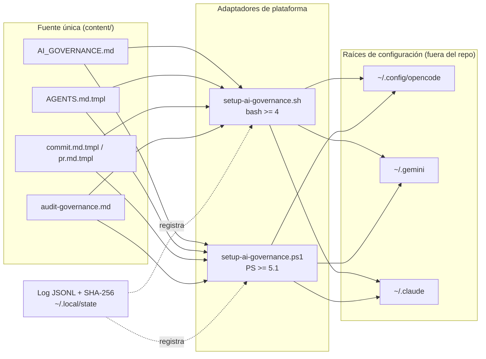
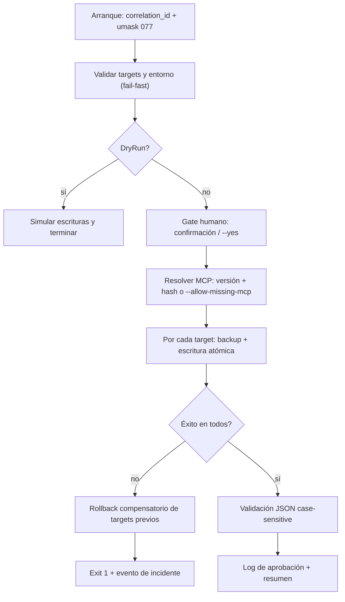

# Arquitectura — `layrz-ia-scripts` v2.3.2

**Norma:** ISO/IEC/IEEE 42010:2022 · **Estado:** propuesto, pendiente de aprobación humana.

## 1. Visión general

Sistema de despliegue determinista con una fuente de contenido, dos adaptadores de plataforma y tres destinos de configuración. No hay componentes de inferencia.

## 2. Flujo de ejecución

## 3. Fronteras de confianza

| Frontera                                             | Tipo                       | Control                                                             |
|------------------------------------------------------|----------------------------|---------------------------------------------------------------------|
| Variables de entorno `AI_AGENT_NAME_*` / `DISPLAY_*` | Entrada no confiable       | Allowlist y límite de longitud antes de interpolar (Pilar 11)       |
| `~/.config/ai-governance/installed.txt`              | Estado local               | Guard de prefijo `is_under_managed_roots` antes de borrar (Pilar 2) |
| Archivos en `content/`                               | entrada confiable del repo | Versionados en Git; sin descarga dinámica (Pilar 10)                |
| Raíces de agentes externos                           | Salida                     | Backup + escritura atómica + uninstall (Pilares 13, 19)             |
| Logs                                                 | Salida sensible            | JSONL, hash encadenado, permisos `0600`, home enmascarado           |

## 4. Componentes y responsabilidades (SRP)

| Componente                             | Responsabilidad única                               |
|----------------------------------------|-----------------------------------------------------|
| `content/*`                            | Contenido literal de la gobernanza; sin lógica      |
| `schemas/opencode-config-v1.json`      | Contrato versionado referenciado desde `$schema`    |
| `config/ai-mcp.lock`                   | AI-BOM: versión y SHA-256 del MCP                   |
| `read_content` / `Get-ContentTemplate` | Cargar plantillas con codificación UTF-8            |
| `apply_agent_subs`                     | Sustituir placeholders validados                    |
| `write_file` / `Write-FileAtomic`      | Backup + escritura atómica + registro en state file |
| `validate_json` / `Validate-JsonFile`  | Comprobar sintaxis con parser case-sensitive        |
| `log_event` / `Write-AuditEvent`       | Emitir JSONL con cadena SHA-256                     |
| `require_human_gate`                   | Bloquear hasta confirmación humana                  |
| `do_uninstall` / `Invoke-Uninstall`    | Revertir archivos gestionados bajo roots permitidos |

## 5. Decisiones arquitectónicas

- [ADR 0001 — Paridad y fuente única de contenido](adr/0001-paridad-y-fuente-unica.md)
- [ADR 0002 — Validación JSON case-sensitive](adr/0002-json-case-sensitive.md)

## 6. Ciclo de vida

Concepción → desarrollo (tests de paridad) → operación (dry-run → gate → despliegue) → mantenimiento (versionado y changelog) → retirada (`--uninstall`). No se requiere despliegue canary: el cambio afecta a archivos de configuración locales y es reversible en un solo paso.
